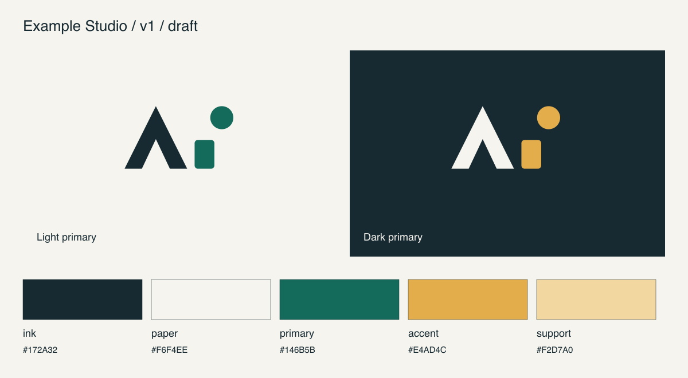

# Draft2Brand

A reusable agent skill that takes a logo draft image and a business brief, helps select a color palette, and builds a complete digital brand asset kit from one editable vector master.

**Draft image → faithful vector → palette choice → consistent exports → reviewed handoff.**



*The example artwork is a tooling fixture, not a client identity or a template for your logo.*

## Use it

Install the skill, attach your draft image, and start with:

```text
Use $draft2brand with this draft.
Company: [name]
Business and audience: [what it does and for whom]
Character: [e.g. precise, warm, bold]
Palette: suggest three directions for me to choose from.
Preserve: [features of the draft that must stay].
Create the complete brand asset kit after we choose.
```

You can instead supply exact colors or say **“Choose the most suitable palette and proceed.”** The skill records that decision and avoids asking for approval again. It checks the draft before drawing, keeps meaningful geometry intact, and separates proposed design choices from approved ones.

The agent performs visual interpretation and vector reconstruction. The included exporter takes a prepared SVG and palette configuration; it is not a one-command image-to-logo model. A compatible agent needs image understanding, local file execution and, for full review, browser access. No API key is required by the exporter.

## Install in Codex

Ask the built-in installer:

```text
$skill-installer install the skill from
https://github.com/hugomrdz/Draft2Brand/tree/main/skills/draft2brand
```

Or clone and link the skill into the user skill directory:

```sh
git clone https://github.com/hugomrdz/Draft2Brand.git
mkdir -p ~/.agents/skills
ln -s "$(pwd)/Draft2Brand/skills/draft2brand" ~/.agents/skills/draft2brand
```

Restart or open a fresh Codex session if the skill does not appear. If a destination named `draft2brand` already exists, inspect it before replacing anything. Local discovery and symlinked skill folders are documented in [OpenAI's skill guide](https://learn.chatgpt.com/docs/build-skills).

## What the kit contains

The full two-accent example produces:

- **9 transparent logo SVGs:** master, light, dark, supporting tone, two dual-accent variants, two monochromes and an isolated symbol.
- **35 profile/icon PNGs:** seven colorways at 1024, 512, 256, 128 and 64 px, with solid backgrounds and space for a circular crop.
- Palette and profile preview sheets, main-mark preview, and a responsive HTML review page.
- `palettes.json`, semantic CSS tokens, usage notes and numerical contrast checks.
- Source geometry, configuration, pinned rebuild tools, file hashes, PNG ZIP and complete-kit ZIP.

Counts adapt to the actual symbol; a one-color mark should not gain unnecessary accents. Brand strategy, naming, typography systems, stationery, packaging and print separations are optional extensions, not silently included deliverables. Draft images and client assets belong in their own workspaces, outside this public repository.

## Run the exporter directly

Requires **Python 3.10+** and **Node 22+**. Sharp is pinned in the renderer lockfile.

```sh
npm ci --prefix skills/draft2brand/scripts
python3 skills/draft2brand/scripts/build_kit.py \
  skills/draft2brand/assets/brand.example.json \
  --out ./artifacts/example-v1
```

Serve the review locally so its download links work consistently:

```sh
python3 -m http.server 8000 --bind 127.0.0.1 --directory ./artifacts/example-v1
```

Open `http://127.0.0.1:8000/review.html`, then stop the server when finished. To use your own artwork, replace the synthetic SVG and config following the [export contract](skills/draft2brand/references/export-contract.md). Never overwrite the original draft; each output uses a new version folder.

The checks compare geometry across color variants, reject external/embedded SVG resources, calculate text/action/focus contrast, and verify PNG sizes, opacity and backgrounds. Inspect the resulting images and browser controls before delivery. Numerical checks alone are not a full accessibility certification.

## Develop and verify

```sh
python3 tests/test_exporter.py
```

This builds a full example, a wide symbol and a reproducible second kit, checks ZIP contents and exact logo/PNG rebuilds, and exercises failure paths for unsafe SVGs, low contrast and existing output folders. The tests use temporary directories.

## Share and publish

This repository distributes the skill publicly on GitHub under MIT. Clone it or use the installation link above. A minimal portable `plugin.json` is also included for hosts supporting skills-only Agent Plugins.

GitHub publication does not create an OpenAI Plugin Directory listing. For that optional listing, package `plugin.json` and `skills/` without dependencies, caches or client files, then follow the [official submission flow](https://developers.openai.com/plugins/deploy/submission). The local-execution requirement is declared using the [desktop-only plugin setting](https://developers.openai.com/plugins/deploy/desktop-only). Publisher verification, required metadata and review are handled by that service.
